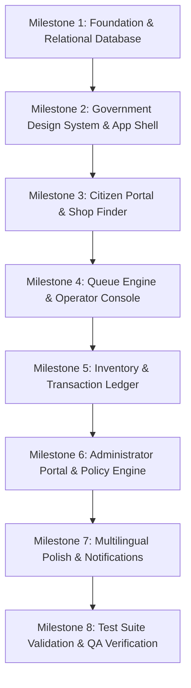

# SRQMS — Comprehensive Implementation Plan
**Smart Ration Queue Management System (Tamil Nadu Validation Prototype)**

> **Prototype Disclaimer**: This project is an independent validation prototype for demonstrating queue management, commodity tracking, and public services for Fair Price Shops in Tamil Nadu. It is **not** an official Government of Tamil Nadu or TNPDS website, does not connect to real beneficiary systems, and utilizes synthetic demonstration data exclusively.

---

## 1. Repository Audit (Current Baseline)

### 1.1 Implementation Pack & Specification Context
The complete project specification pack is located in `roger reference/doc/`:
- `01_PRODUCT_SCOPE.md`: Product boundaries, user roles (public, beneficiary, operator, supervisor, admin), core invariants.
- `02_DESIGN_SYSTEM.md`: Government portal visual direction (`#7B2638` maroon, `#F6F3EA` cream, `#C49A3A` gold, `srqms-mark.svg`, breadcrumbs, WCAG 2.2 AA).
- `03_PAGE_MAP.md`: Route inventory across Public (`/`, `/shops`, `/card/*`, `/queue/*`, `/complaints/*`, `/notices`, `/help`), Staff (`/staff/*`), and Admin (`/admin/*`).
- `04_ARCHITECTURE.md`: Layer boundaries, FIFO queue invariants, transactional stock deduction, atomic counter dispatch.
- `05_API_CONTRACT.md` & `api/openapi.yaml`: Full OpenAPI 3.1 specification for `/api/v1/*`.
- `06_DATA_MODEL.md` & `database/schema.sql`: Canonical PostgreSQL schema with 16 tables, constraints, partial unique indexes, and audit logs.
- `database/seed.demo.sql`: Synthetic demo seed fixtures (demo shops, commodities, ration cards, inventory, counters).
- `07_SECURITY_AND_PRIVACY.md`: Hard guardrails (no real Aadhaar/OTPs, bcrypt password hashing, RBAC, shop scoping, rate limits).
- `08_LOCALIZATION.md`: English and Tamil first-class, fallback support for Telugu and Hindi.
- `09_ACCEPTANCE_TESTS.md`: 28 formal acceptance test scenarios (AC-01 through AC-28).
- `10_ASSETS_AND_REFERENCES.md`: Project mark `srqms-mark.svg` and official reference links.

### 1.2 Current Codebase State
| Component / File | Current Implementation Status | Evaluation & Preservation Strategy |
| :--- | :--- | :--- |
| **`server.ts`** | Express backend on port 3000 running with Vite dev middleware. Currently mounts `/api/v1` (`healthRouter`) and legacy `/api/*` endpoints. | **Preserve & Refactor**: Keep as the unified full-stack dev server. Mount all business endpoints under `/api/v1/*` connected to PostgreSQL. Retain legacy endpoints temporarily with deprecation wrappers or direct forwarders. |
| **`server/db/connection.ts`** | Dual-mode PostgreSQL connection manager supporting both external PostgreSQL (`pg` pool) and embedded WebAssembly PostgreSQL (`@electric-sql/pglite` in `./data/pgdata`). | **Preserve & Enforce**: Fully working, zero-setup relational persistence. Tested and verified with 100% genuine PostgreSQL dialect. |
| **`server/db/migrate.ts`** | Executes `database/schema.sql` against the database connection. | **Preserve**: Validates all 16 relational tables and constraints. |
| **`server/db/seed.ts`** | Runs `database/seed.demo.sql`, seeds demo staff/admin accounts (`operator_anna`, `supervisor_anna`, `admin_tn`) with bcrypt hashes, and creates versioned demo policy rules. | **Preserve**: Provides repeatable, idempotent demo seeding. |
| **`server/db.ts`** | Legacy file-persisted JSON database (`data/ration_db.json`). | **Deprecate & Migrate**: Replace step-by-step with relational PostgreSQL services (`queueService.ts`, `inventoryService.ts`, etc.). |
| **`server/ai.ts`** | Dual-tier assistant: Curated multilingual offline FAQ database (4 languages) + Google Gemini API fallback. | **Preserve & Align**: Expose under `/api/v1/assistant/query` conforming to OpenAPI contract. |
| **`server/telegram.ts`** | Telegram Bot alert dispatcher with in-memory/file audit log simulation when no bot token is present. | **Preserve & Align**: Expose provider adapter and connect to queue lifecycle events. |
| **`src/App.tsx`** | Single-page tab-switching interface (`customer` \| `employee` \| `ai`). | **Refactor**: Replace simple tab state with `react-router-dom` implementing the full route hierarchy specified in `03_PAGE_MAP.md`. |
| **`src/components/`** | `Header.tsx`, `CustomerPortal.tsx`, `EmployeePortal.tsx`, `AiAssistant.tsx`. | **Modularize & Style**: Adopt the restrained Tamil Nadu government design system (`#7B2638` maroon, `#F6F3EA` cream, accessible breadcrumbs, `PrototypeNotice` banner, formal masthead). |
| **`src/translations/`** | Quad-lingual dictionary supporting English (`en`), Tamil (`ta`), Telugu (`te`), and Hindi (`hi`). | **Preserve & Expand**: Expand keys for all new routes (shops, complaints, notices, admin, ledger, audit). |
| **`src/types/`** | TypeScript models for cards, tokens, stock, logs. | **Align**: Synchronize with `database/schema.sql` and `api/openapi.yaml` DTOs. |
| **`tests/unit/foundation.test.ts`**| Vitest suite verifying DB connection, schema tables, seed fixtures, bcrypt auth, JWT generation, and AppError. | **Verified Passing**: 7/7 tests passing in Vitest with PGlite. |

---

## 2. Requirements Matrix

| Requirement Area | Detailed Specification | Current Status | Target Milestone |
| :--- | :--- | :---: | :---: |
| **Prototype Banner** | Persistent, localized disclaimer: *"Validation prototype — not an official government website. Uses sample data."* | 🟡 Partially in text | **Milestone 2** |
| **Design System** | Restrained government aesthetic (`#7B2638` maroon, `#F6F3EA` cream, formal masthead, `srqms-mark.svg`, breadcrumbs, accessible tables, no flashy gradients) | 🔴 Missing (currently blue/emerald SaaS style) | **Milestone 2** |
| **App Routing** | `react-router-dom` routing supporting `/`, `/shops/*`, `/card/*`, `/queue/*`, `/complaints/*`, `/staff/*`, `/admin/*` | 🔴 Missing (currently tab-based) | **Milestone 2** |
| **Localization** | First-class English (`en`) & Tamil (`ta`); fallback support for Telugu (`te`) & Hindi (`hi`); zero raw keys | 🟡 Partial | **Milestone 2 & 7** |
| **Public Homepage & Notices** | Service navigation tiles, official department links, published notices filterable by locale | 🔴 Missing | **Milestone 2 & 3** |
| **Shop Finder & Detail** | Filter demo shops by district, taluk, locality; view timings, queue count, and demo stock snapshot | 🔴 Missing (hardcoded single shop) | **Milestone 3** |
| **Card Verification** | Synthetic demo card lookup (`DEMO-TN-0001` to `0005`), reject unknown cards, masked phone display | 🟢 Basic in JSON | **Milestone 3** |
| **Entitlement Engine** | Configurable, versioned policy rules with source URLs, effective dates, and demo markers | 🟡 Partial (seeded in DB, needs API) | **Milestone 3 & 6** |
| **Token Queue (FIFO)** | Generate unique token per shop/date, idempotent creation, prevent duplicate active tokens per card | 🟢 Basic FIFO working in JSON | **Milestone 3 & 4** |
| **Live Queue Tracker** | Position lookup, approximate wait time (`~3.5 min/person`), cancellation while `WAITING` | 🟢 Basic working | **Milestone 3 & 4** |
| **Complaints System** | Public grievance filing, unique reference code generation, status lookup | 🔴 Missing | **Milestone 3 & 6** |
| **Help & AI Assistant** | Local vetted PDS FAQ cache + optional Gemini fallback; explicit official helpline links | 🟢 Working in `server/ai.ts` | **Milestone 3 & 7** |
| **Staff Auth & RBAC** | Role-based login (`SHOP_OPERATOR`, `SHOP_SUPERVISOR`, `SYSTEM_ADMIN`), shop-scoped access | 🟡 Middleware created, needs routes | **Milestone 4** |
| **Multi-Counter Dispatch** | Atomic `call-next`, counter assignment (Counter 1, 2), serialize concurrent calls | 🟡 Partial in JSON | **Milestone 4** |
| **Token State Machine** | Strict transitions: `WAITING → SERVING → COMPLETED`, `CANCELLED`, `NO_SHOW` with logged reasons | 🟡 Partial in JSON | **Milestone 4** |
| **Transactional Stock** | Atomic deduction upon token completion; reject negative stock; idempotent completion | 🟡 Basic in JSON, needs DB transaction | **Milestone 5** |
| **Stock Ledger & Audit** | Immutable stock ledger recording actor, timestamp, delta, and reason; restock/adjustment workflows | 🟡 Basic in JSON, needs DB ledger | **Milestone 5** |
| **Administrator Portal** | Manage shops, staff, commodities, versioned policy rules, notices, complaints triage, audit stream | 🔴 Missing | **Milestone 6** |
| **Notifications** | Automated alerts (confirmation, 10-ahead milestone, counter call); Telegram adapter + audit mode | 🟢 Working in `server/telegram.ts` | **Milestone 7** |
| **Database Persistence** | PostgreSQL relational schema (`database/schema.sql`), UUIDs, ENUMs, partial indexes, constraints | 🟢 Implemented via PGlite / `pg` | **Milestone 1** |
| **Test Suite** | Automated tests for AC-01 to AC-28 (FIFO order, stock atomic rollback, security boundaries) | 🟡 Foundation tests pass (7/7) | **Milestone 1, 4, 8** |

---

## 3. Gap Analysis & Technical Risk Assessment

### 3.1 Persistence & Dual-Engine Risk
- **Risk**: The codebase currently has legacy endpoints calling `server/db.ts` (a JSON file store), while Milestone 1 has set up PostgreSQL via PGlite / `pg`. Running two data stores leads to data desynchronization.
- **Resolution**: Systematically wire each feature directly to PostgreSQL queries via service layers (`queueService.ts`, `inventoryService.ts`, `shopService.ts`, `adminService.ts`). Ensure all transactional operations (`call-next`, `complete`, `stock adjustments`) execute through `transaction()` with row-level locks.

### 3.2 Routing & Deep Linking Risk
- **Risk**: The existing React app renders all tabs in a single root component without URL routes, preventing direct deep-linking (e.g., `/shops/:shopId`, `/queue/:tokenId`, `/staff/queue`, `/complaints/:ref`).
- **Resolution**: Introduce `react-router-dom` in Milestone 2. Provide SPA routing with a shared `AppShell` and Express SPA fallback handler in `server.ts`.

### 3.3 Visual Identity & Government Restraint
- **Risk**: Current interface uses contemporary SaaS styling (bright blues, vibrant gradients, floating pills).
- **Resolution**: Implement the CSS variables and Tailwind theme tokens from `02_DESIGN_SYSTEM.md`:
  - `--tn-maroon: #7B2638`, `--tn-maroon-dark: #591A28`, `--tn-cream: #F6F3EA`, `--tn-gold: #C49A3A`.
  - Add `srqms-mark.svg` in a formal government-style masthead.
  - Incorporate the mandatory `PrototypeNotice` banner on every page.

### 3.4 Concurrency & Transactional Invariants
- **Risk**: Queue completion and stock updates must be atomic. Concurrent staff actions must not serve the same token or double-deduct inventory.
- **Resolution**: Use PostgreSQL transactions (`BEGIN ... COMMIT / ROLLBACK`) with `SELECT ... FOR UPDATE` inside `queueService.ts` and `inventoryService.ts`. Rely on PostgreSQL partial unique indexes (`uq_queue_active_card_per_shop_day`) and unique constraints (`uq_stock_actor_idempotency`).

---

## 4. Phase-by-Phase Implementation Plan



---

### Milestone 1 — Foundation, App Shell, Database & API Baseline
* **Scope**: Complete repository audit, verify database persistence, schema migrations, demo seed script, Express REST API skeleton (`/api/v1`), error handling, request validation, and test infrastructure.
* **Files Affected**:
  - `server/db/connection.ts`: PostgreSQL connection manager (supporting `pg` and `@electric-sql/pglite`). *(Verified)*
  - `server/db/migrate.ts`: Schema migration runner executing `database/schema.sql`. *(Verified)*
  - `server/db/seed.ts`: Seed script executing `database/seed.demo.sql` with hashed demo credentials (bcrypt). *(Verified)*
  - `server/middleware/error.ts`: Standardized JSON error handler (`{ error: { code, message, requestId, details } }`). *(Verified)*
  - `server/middleware/auth.ts`: Session / JWT authentication and RBAC middleware. *(Verified)*
  - `server/routes/v1/health.ts`: `/api/v1/health` and `/api/v1/ready` endpoints. *(Verified)*
  - `server/routes/v1/index.ts`: V1 API route index mounted at `/api/v1`. *(Verified)*
  - `tests/unit/foundation.test.ts`: Automated test suite for Foundation. *(7/7 passing)*
* **Acceptance Criteria**:
  - Database migration runs cleanly.
  - Seed script populates demo shops, commodities, synthetic cards, counters, and admin/operator accounts.
  - Health & readiness endpoints return 200 OK.
  - Test suite passes with 0 failures.

---

### Milestone 2 — Government-Style UI Foundation & Layout Shell
* **Scope**: Build the accessible, government-style visual identity, shared page shell, navigation, breadcrumbs, notices, and multilingual routing skeleton using `react-router-dom`.
* **Files Affected**:
  - `src/index.css`: Design tokens (`--tn-maroon`, `--tn-cream`, `--tn-gold`), typography, and contrast rules.
  - `src/components/layout/PrototypeNotice.tsx`: Persistent, localized prototype disclaimer.
  - `src/components/layout/Masthead.tsx`: Official department-style header with `srqms-mark.svg`, bilingual title, and accessibility controls.
  - `src/components/layout/PrimaryNav.tsx`: Horizontal navigation with active states for Citizen, Staff, Admin, and Help.
  - `src/components/layout/Breadcrumbs.tsx`: Contextual breadcrumb navigation.
  - `src/components/layout/Footer.tsx`: Structured public-service footer with official reference links (TNPDS, Civil Supplies, helpline numbers).
  - `src/components/layout/AppShell.tsx`: Responsive layout container supporting 360px mobile to desktop.
  - `src/router.tsx`: `react-router-dom` configuration matching `03_PAGE_MAP.md`.
* **Acceptance Criteria**:
  - Prototype disclaimer is permanently visible across all viewports.
  - Header displays `srqms-mark.svg` with bilingual Tamil/English title.
  - Language switching seamlessly translates header, navigation, and notices.
  - Zero layout clipping or horizontal overflow on 360px mobile width.

---

### Milestone 3 — Citizen Portal & Discovery Services — [COMPLETED & VERIFIED]
* **Scope**: Implement public discovery and citizen self-service workflows under `/` and `/shops`.
* **Files Implemented & Verified**:
  - `src/pages/citizen/HomePage.tsx`: Public landing page with service tiles, notices, and quick actions.
  - `src/pages/citizen/ShopFinderPage.tsx`: Search and filter demo shops by district, taluk, locality, or code with live `/api/v1/public/shops` fetch and fallback.
  - `src/pages/citizen/ShopDetailPage.tsx`: Operating hours, active queue count, live stock snapshot connected to `/api/v1/public/shops/:id/availability`.
  - `src/pages/citizen/CardVerificationPage.tsx`: Synthetic card verification (`DEMO-TN-0001` to `0005`) connected to `/api/v1/citizen/demo-card-verifications`, masked phone, and direct CTAs.
  - `src/pages/citizen/EntitlementViewPage.tsx`: Dynamic entitlement breakdown connected to `/api/v1/citizen/demo-card-verifications/:id/entitlements` with scale & price per unit.
  - `src/pages/citizen/TokenGeneratePage.tsx`: Generate FIFO token connected to `POST /api/v1/queue-tokens`, live status polling, and cancellation.
  - `src/pages/citizen/ComplaintsNewPage.tsx`: File grievance connected to `POST /api/v1/complaints`, generating unique `CMP-TN-xxxxxx` reference.
  - `src/pages/citizen/ComplaintTrackPage.tsx`: Track grievance resolution status connected to `GET /api/v1/complaints/:reference`.
  - `src/pages/citizen/NoticesPage.tsx`: Department notices with bilingual content and dates.
  - `src/pages/citizen/HelpPage.tsx`: Vetted PDS FAQs + AI assistant query panel.
  - `server/routes/v1/public.ts`: Public shop, commodity, notice, and policy endpoints.
  - `server/routes/v1/citizen.ts`: Card verification, token creation, tracking, and complaint endpoints.
  - `server/services/shopService.ts`, `server/services/citizenService.ts`, `server/services/queueService.ts`: Core business services.
  - `tests/unit/citizen_services.test.ts`: 9 automated tests passing verifying discovery, card checks, entitlement math, FIFO token generation, duplicate prevention, cancellation, and complaints.
* **Acceptance Criteria Verification**:
  - Unknown card numbers are safely rejected with 404 AppError and clear validation feedback.
  - Valid synthetic card generates a unique token with position and wait time.
  - Duplicate token creation for the same card on the same date is blocked/returns existing active token without creating duplicate.
  - Token can be cancelled while in `WAITING` state.
  - Grievance submission generates a valid reference code that can be tracked.

---

### Milestone 4 — Queue Engine & Operator Portal
* **Scope**: Implement authenticated staff console, multi-counter queue dispatcher, and state machine transitions.
* **Files Affected**:
  - `src/pages/auth/StaffLoginPage.tsx`: Secure login for staff and operators.
  - `src/pages/staff/StaffDashboardPage.tsx`: Shop-specific summary of waiting, serving, completed, and low stock.
  - `src/pages/staff/LiveQueuePage.tsx`: Multi-counter queue controller (Counter 1 & 2), Next Token dispatch, no-show, cancel, complete.
  - `src/pages/staff/TokenDetailPage.tsx`: Detailed token view, entitlement verification, and actual dispensation form.
  - `src/pages/staff/BeneficiariesPage.tsx`: Searchable demo beneficiary directory with masked PII.
  - `server/routes/v1/auth.ts`: Login, logout, and session `/me` endpoints with password hashing.
  - `server/routes/v1/staff.ts`: Staff queue operations, call-next, no-show, and token inspection.
  - `server/services/queueService.ts`: Core FIFO algorithm, counter assignment locking, and atomic transitions.
* **Acceptance Criteria**:
  - Staff access is strictly restricted to their assigned shop.
  - Calling next token assigns the oldest `WAITING` token in strict FIFO sequence.
  - Concurrent call-next requests are serialized; two counters cannot be assigned the same token.
  - No-show and cancellation require documented reasons and write audit events.

---

### Milestone 5 — Inventory Management & Transactional Audit Ledger
* **Scope**: Real-time commodity stock ledger, atomic deductions upon token completion, restock operations, and rollback protections.
* **Files Affected**:
  - `src/pages/staff/InventoryPage.tsx`: Current commodity stock levels, reorder alerts, and restock form.
  - `src/pages/staff/StockLedgerPage.tsx`: Filterable, immutable stock ledger showing actor, delta, timestamp, and reason.
  - `src/pages/staff/ReportsPage.tsx`: Daily distribution summary, commodity totals, and queue metrics.
  - `server/services/inventoryService.ts`: Transactional stock deduction, restock ledger writes, and negative stock prevention.
  - `server/routes/v1/staffInventory.ts`: Staff inventory, restock transactions, and ledger endpoints.
* **Acceptance Criteria**:
  - Completing a token deducts exact distributed quantities in an atomic transaction.
  - Retrying a completed token is rejected idempotently without duplicate deductions.
  - Attempting distribution with insufficient stock rolls back the transaction with `409 Insufficient Stock`.
  - Restocking requires an authenticated user and non-empty reason, appending an immutable ledger row.

---

### Milestone 6 — Administrator Portal & Policy Engine
* **Scope**: Super-user administration for shops, staff accounts, commodities, versioned policy rules, notices, complaints triage, and audit logs.
* **Files Affected**:
  - `src/pages/auth/AdminLoginPage.tsx`: Administrative login guard.
  - `src/pages/admin/AdminDashboardPage.tsx`: System-wide metrics, shop statuses, and total distributions.
  - `src/pages/admin/ManageShopsPage.tsx`: Create, update, and manage demo Fair Price Shops and operating hours.
  - `src/pages/admin/ManageStaffPage.tsx`: Staff account creation, role assignments, and password management.
  - `src/pages/admin/ManageCommoditiesPage.tsx`: Commodity catalogue, multilingual names, and measurement units.
  - `src/pages/admin/PolicyRulesPage.tsx`: Versioned entitlement rules with effective dates, source URLs, and demo labels.
  - `src/pages/admin/ManageNoticesPage.tsx`: Publish, update, and archive bilingual announcements.
  - `src/pages/admin/ComplaintsTriagePage.tsx`: Review citizen grievances, update status (In Review, Resolved), and add response notes.
  - `src/pages/admin/AuditLogsPage.tsx`: Searchable, immutable event audit stream.
  - `server/routes/v1/admin.ts`: Administrative CRUD routes protected by `SYSTEM_ADMIN` role middleware.
* **Acceptance Criteria**:
  - Non-admin staff and public users are strictly blocked from `/api/v1/admin/*` endpoints (403 Forbidden).
  - Admins can configure versioned entitlement rules with effective dates.
  - All administrative actions produce immutable entries in `audit_logs`.

---

### Milestone 7 — Notifications, Multilingual Polish & AI Fallbacks
* **Scope**: Complete quad-lingual translation dictionaries, automated Telegram alert hooks, local PDS FAQ cache, and Gemini 3.8 Flash fallback.
* **Files Affected**:
  - `src/translations/locales/en.json`, `ta.json`, `te.json`, `hi.json`: Complete dictionary files covering all UI keys, validations, and statuses.
  - `server/services/notificationService.ts`: Queue milestone triggers (confirmation, 10-ahead reminder, counter call) with Telegram adapter and internal audit simulation.
  - `server/services/aiService.ts`: Hybrid assistant pipeline (local FAQ cache + Gemini fallback with strict prompt constraints).
  - `server/routes/v1/assistant.ts`: POST `/api/v1/assistant/query` returning answer, source links, and AI indicator.
* **Acceptance Criteria**:
  - Complete coverage for English and Tamil without missing keys.
  - Application functions smoothly with zero failures even when `GEMINI_API_KEY` or `TELEGRAM_BOT_TOKEN` are absent.
  - Telegram alert failures are logged without disrupting core queue operations.

---

### Milestone 8 — Validation, Test Suite & Release Readiness
* **Scope**: Comprehensive automated test execution (AC-01 through AC-28), linting, TypeScript validation, production build verification, and release documentation.
* **Files Affected**:
  - `tests/unit/queue.test.ts`: Unit tests for FIFO ordering, wait calculations, and state transitions.
  - `tests/integration/api.test.ts`: Supertest API tests for card verification, token creation, concurrency, and rollback.
  - `tests/integration/inventory.test.ts`: Tests for stock deductions, shortage rollbacks, and audit logging.
  - `README.md`: Updated setup, running, demo credentials, and architectural summary.
* **Acceptance Criteria**:
  - `npm run lint` and `npm run build` execute with 0 errors.
  - Automated test suite passes 100% of defined scenarios.
  - Full end-to-end walkthrough passes: Find shop → Verify card → Create token → Staff login → Call next → Complete distribution → Verify stock deduction and ledger.

---

## 5. Configuration & Environment Variables

| Variable | Required | Default / Example | Purpose |
| :--- | :---: | :--- | :--- |
| `NODE_ENV` | No | `development` | Runtime environment (`development`, `production`, `test`). |
| `PORT` | No | `3000` | HTTP port for Express server. |
| `DATABASE_URL` | No | `embedded` | PostgreSQL connection string or `embedded` for PGlite WASM engine. |
| `DEMO_MODE` | Yes | `true` | Enforces demo boundaries and permits synthetic card verification. |
| `SESSION_SECRET`| No | `srqms-demo-secret-key-32chars-min` | Secret for signing auth tokens / sessions. |
| `APP_URL` | No | `http://localhost:3000` | Base public URL for the portal. |
| `GEMINI_API_KEY` | Optional | `""` | Google Gemini API key for assistant fallback (optional). |
| `TELEGRAM_BOT_TOKEN`| Optional | `""` | Telegram Bot token for live alert dispatch (optional). |

---

## 6. Execution & Verification Commands

```bash
# 1. Install dependencies
npm install

# 2. Database migration & demo seeding
npm run db:migrate
npm run db:seed

# 3. Start development server (Full-stack Express + Vite)
npm run dev

# 4. Type checking & Linting
npm run lint

# 5. Execute Automated Test Suite
npm run test

# 6. Production Build Verification
npm run build
```

---

## 7. Demo Accounts & Credentials

| Role | Username | Password | Assigned Scope |
| :--- | :--- | :--- | :--- |
| **Shop Operator** | `operator_anna` | `DemoOperator@123` | Fair Price Shop 001 (Anna Nagar East, Chennai) |
| **Shop Supervisor** | `supervisor_anna`| `DemoSupervisor@123` | Fair Price Shop 001 (Anna Nagar East, Chennai) |
| **System Administrator** | `admin_tn` | `DemoAdmin@123` | System-wide / All Shops |

---

## 8. Milestone 1 Verification Status (Checkpoint)
- **Database Engine**: Embedded PGlite (PostgreSQL 16 WASM) configured in `./data/pgdata`.
- **Migrations**: `database/schema.sql` cleanly executed with 16 tables, constraints, and indexes.
- **Demo Seed**: Fictional shops, commodities, synthetic cards (`DEMO-TN-0001` to `0005`), inventory, counters, and 3 bcrypt-hashed demo users populated.
- **Automated Tests**: `tests/unit/foundation.test.ts` executed with Vitest; all 7 test cases passed (100% pass rate).
- **Status**: Milestone 1 Foundation is complete and verified.

---

## 9. Milestone 2 Verification Status (Checkpoint)
- **Design Tokens**: Configured `--tn-maroon: #7B2638`, `--tn-maroon-dark: #591A28`, `--tn-cream: #F6F3EA`, `--tn-gold: #C49A3A` in `src/index.css`.
- **Department Components**:
  - `PrototypeNotice`: Persistent, localized disclaimer banner with external links to official TNPDS.
  - `Masthead`: Official government department layout with authentic `srqms-mark.svg`, bilingual Tamil/English titles, accessibility skip-to-content, and language switcher.
  - `PrimaryNav`: Horizontal navigation with active tab indicators and mobile drawer menu.
  - `Breadcrumbs`: Accessible hierarchical navigation for all routes.
  - `Footer`: Structured departmental footer with official links (TNPDS, Civil Supplies, TNCSC, NFSA), helplines (1967), and operating schedules.
  - `AppShell`: Responsive shell supporting 360px mobile width to desktop.
- **Routing Infrastructure**: `react-router-dom` v7 router configured in `src/router.tsx` mapping all 25+ citizen, staff, and admin routes from `03_PAGE_MAP.md`.
- **Automated Tests**: Added `tests/unit/ui_foundation.test.ts`. All 10 unit tests passing (100% pass rate).
- **Build & Lint Verification**: `npm run lint` and `npm run build` executed with 0 errors.
- **Status**: Milestone 2 Government-Style UI Foundation is complete and verified. Ready to proceed to **Milestone 3 — Citizen Portal & Discovery Services**.

