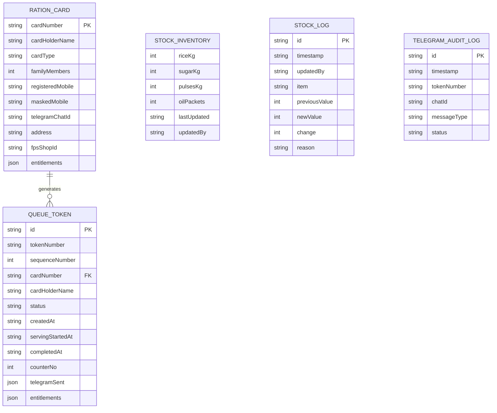

# Project Report: Smart Ration Queue Management System (SRQMS)
**Public Distribution System (PDS) Digital Transformation Platform**

---

## 1. Executive Summary

The **Smart Ration Queue Management System (SRQMS)** is a full-stack, modern digital solution engineered to resolve the chronic challenges of overcrowding, lack of visibility, long waiting hours, and stock opacity in government Fair Price Shops (FPS) under the Indian Public Distribution System (PDS).

Operating strictly on **First-In First-Out (FIFO)** queuing principles, the platform bridges beneficiaries and FPS shop staff through two synchronized portals:
1. **Customer Self-Service Portal**: Instant ration card verification, dynamic entitlement calculation under the National Food Security Act (NFSA), automated digital token generation, real-time wait-time estimation, and automated Telegram queue alert notifications.
2. **Employee / Shop Operator Portal**: Live multi-counter queue management, automated stock deductions during distribution, inventory auditing, restock logging, and beneficiary record lookup.

The system features **quad-lingual localization** (English, Tamil, Telugu, Hindi) and a hybrid **AI Assistant powered by Google Gemini 3.8 Flash** paired with a zero-latency local PDS policy cache.

---

## 2. Problem Statement & Motivation

### 2.1 The Traditional PDS Landscape
The Indian Public Distribution System is the world's largest food security network, distributing subsidized foodgrains to over 800 million citizens via more than 500,000 Fair Price Shops. Despite biometric point-of-sale (PoS) rollouts, day-to-day operations suffer from:
- **Severe Physical Queuing**: Beneficiaries often wait 2 to 4 hours in extreme weather conditions without knowing their queue standing.
- **Stock Uncertainty**: Citizens stand in line only to find that specific commodities (such as pulses or fortified cooking oil) are out of stock.
- **Digital Exclusion & Language Gaps**: Most systems lack intuitive vernacular interfaces for non-English speaking citizens.
- **Lack of Proactive Communication**: Beneficiaries cannot leave the shop premises without forfeiting their position in the physical queue.

### 2.2 The Proposed Solution
SRQMS replaces unorganized physical crowding with a structured, transparent, and humane digital workflow:
- Beneficiaries secure a token remotely or upon arrival.
- They receive real-time updates and Telegram notifications when their turn approaches (e.g., when 10 citizens remain ahead).
- Shop staff gain real-time stock control and distribution tracking.

---

## 3. System Architecture & Tech Stack

```
+-----------------------------------------------------------------------------------+
|                                  CLIENT LAYER                                     |
|  +---------------------------+  +--------------------------+  +-----------------+  |
|  |   Customer Portal (Web)   |  |  Employee Portal (Web)   |  |   AI Assistant  |  |
|  +---------------------------+  +--------------------------+  +-----------------+  |
|         React 19 | Tailwind CSS v4 | Lucide Icons | Motion | Multilingual i18n    |
+-----------------------------------------------------------------------------------+
                                          |
                                    REST API / JSON
                                          v
+-----------------------------------------------------------------------------------+
|                                 APPLICATION LAYER                                 |
|               Express.js + TypeScript (Node.js v22 Runtime via tsx)               |
|                                                                                   |
|  +-----------------------+  +------------------------+  +----------------------+  |
|  |  Queue Manager (FIFO) |  |   Stock Inventory API  |  |  Card Verification   |  |
|  +-----------------------+  +------------------------+  +----------------------+  |
|  | Telegram Alert Worker |  |   Gemini 3.8 Flash AI  |  |  PDS Rule Engine     |  |
|  +-----------------------+  +------------------------+  +----------------------+  |
+-----------------------------------------------------------------------------------+
                                          |
                                          v
+-----------------------------------------------------------------------------------+
|                               DATA PERSISTENCE LAYER                              |
|                       JSON Data Store (data/ration_db.json)                       |
|   - Ration Cards       - Active & Historic Queue      - Stock Balances            |
|   - Stock Audit Logs   - Telegram Dispatch Logs       - Sequence Counters         |
+-----------------------------------------------------------------------------------+
```

### 3.1 Technology Stack Details

| Domain | Technology / Library | Version / Detail | Justification |
| :--- | :--- | :--- | :--- |
| **Frontend Framework** | React | `19.0.1` | Ultra-fast declarative UI rendering, concurrent features, modern hooks. |
| **Styling & Design** | Tailwind CSS + Vite Plugin | `@tailwindcss/vite ^4.3.3` | Utility-first, responsive, zero-runtime overhead styling. |
| **UI Motion & Icons** | Lucide React + Motion | `^0.546.0` / `^12.23.24` | Accessible visual cues, smooth status transitions, tactile user feedback. |
| **Build & Bundling** | Vite | `^8.3.0` | Sub-millisecond HMR, optimized ESM bundling, dev-middleware integration. |
| **Backend Framework** | Express.js | `^4.21.2` | Minimalist HTTP routing, REST endpoints, Vite middleware support. |
| **Runtime & Language** | TypeScript + tsx | Node v22 / TS 7 / tsx `^4.21.0` | End-to-end type safety, instant execution without manual build steps. |
| **Artificial Intelligence**| Google GenAI SDK | `@google/genai ^2.4.0` | Gemini 3.8 Flash model for vernacular PDS policy inquiries. |
| **Notifications** | Telegram Bot API | HTTPS / Polling fallback | Real-time automated alerts without SMS gateway transaction costs. |
| **Database** | File-backed JSON DB | ACID-like atomic writes | Zero external database dependencies; fully portable for edge deployment. |

---

## 4. Key Functional Modules

### 4.1 Customer Portal (`CustomerPortal.tsx`)
1. **Ration Card Verification**:
   - Beneficiaries input their card number (e.g., `TN-02-PHH-8821`).
   - Automatic card type identification:
     - **PHH (Priority Household)**: 5 kg rice per person/month.
     - **AAY (Antyodaya Anna Yojana)**: 35 kg foodgrain basket per family/month.
     - **NPHH (Non-Priority Household)**: Standard state baseline quota.
   - PII protection: Masked registered telephone display (`+91 ******3456`).
2. **One-Click Token Generation**:
   - Generates an alphanumeric token identifier (e.g., `A-101`, `B-102`).
   - Prevents duplicate active tokens per card.
   - Displays real-time wait estimation (calculated as `customersAhead × 3.5 minutes`).
3. **Live Position Tracker**:
   - Current token being served at counter.
   - Position index and number of customers ahead.
   - Audio/visual status indicators (Waiting, Serving, Completed, Cancelled).

### 4.2 Employee / FPS Operator Portal (`EmployeePortal.tsx`)
1. **Queue Dispatch Controller**:
   - Next Token calling with counter assignment (Counter 1, Counter 2).
   - "Call Next Customer", "Mark Dispensation Completed", or "Cancel / No-show".
2. **Automated Stock Deduction**:
   - When a token is marked `COMPLETED`, the beneficiary's exact monthly entitlements are automatically deducted from the shop's live stock ledger.
3. **Inventory Management & Audit Log**:
   - Real-time stock counters for **Rice (kg)**, **Sugar (kg)**, **Pulses (kg)**, and **Fortified Oil (Packets)**.
   - Restock replenishment form with required reason logging (e.g., "Weekly Supply Delivery", "Damage Adjustment").
   - Complete historical ledger of every stock modification with timestamps.
4. **Beneficiary Registry**:
   - Searchable database of registered ration cards in the FPS catchment area.

### 4.3 Multilingual Localization Engine (`src/translations/index.ts`)
The application natively supports 4 major languages with full localized terminology:
- **English (`en`)**
- **Tamil (`ta` - தமிழ்)**
- **Telugu (`te` - తెలుగు)**
- **Hindi (`hi` - हिंदी)**

Every UI component, validation error, entitlement label, and status badge translates dynamically without page reload.

### 4.4 Automated Telegram Alert System (`server/telegram.ts`)
Beneficiaries can supply their Telegram handle/Chat ID to receive automated updates:
1. **Confirmation Alert**: Dispatched immediately upon token generation with assigned token number, current position, and estimated wait time.
2. **10-Ahead Milestone Alert**: Triggered automatically when queue advancement reduces people ahead to 10, alerting the beneficiary to return to the shop premises.
3. **Counter Call Alert**: Dispatched the moment the operator clicks "Call Token", directing the customer to their designated counter.
4. **Offline / Audit Mode**: If no Telegram Bot token is configured, alerts are recorded to an internal audit trail (`GET /api/telegram/audit`) for compliance demonstration.

### 4.5 AI Assistant Module (`server/ai.ts` & `AiAssistant.tsx`)
A dual-layer intelligence pipeline:
- **Layer 1: Zero-Latency Local FAQ Cache**: Matches common queries (ration prices, timings, quotas, helpline numbers 1967/1800-425-5901) locally across all 4 languages.
- **Layer 2: Gemini 3.8 Flash Fallback**: For complex or nuanced user questions, the backend queries Google Gemini with strict prompt constraints (concise, factual, Indian PDS context, response in user's selected language).

---

## 5. Database Schema & Data Models

The persistence engine is housed in `server/db.ts` and synchronizes to `data/ration_db.json`.



---

## 6. Security, Privacy & Compliance Measures

1. **Personally Identifiable Information (PII) Masking**:
   - Beneficiary phone numbers are masked on all client-facing screens (`+91 ******3456`).
2. **Credential Isolation**:
   - Sensitive credentials (`GEMINI_API_KEY`, `TELEGRAM_BOT_TOKEN`) are strictly confined to the backend server and loaded through environment variables.
3. **Idempotent Queue Operations**:
   - Ration cards cannot hold more than one `WAITING` or `SERVING` token concurrently, eliminating queue duplicate fraud.
4. **Stock Reconciliation Trail**:
   - Stock cannot be changed without creating an immutable entry in `stockLogs` documenting previous value, new value, and authorized reason.

---

## 7. Setup & Execution Guide

### 7.1 Prerequisites
- **Node.js**: v18.0.0 or higher (v20+ / v22 recommended)
- **npm**: v9.0.0 or higher

### 7.2 Installation Steps
```bash
# 1. Navigate to the project root directory
cd SMART-RATION-SHOP

# 2. Install dependencies
npm install

# 3. Configure environment variables (optional for live Telegram / Gemini)
cp .env.example .env
```

### 7.3 Configuration (`.env`)
```env
# Optional: Set your Google Gemini API key for dynamic AI assistant query answers
GEMINI_API_KEY="your-gemini-api-key"

# Optional: Set your Telegram Bot Token from @BotFather for real alerts
TELEGRAM_BOT_TOKEN="your-telegram-bot-token"

# Base Application Host URL
APP_URL="http://localhost:3000"
```

### 7.4 Running the Application
```bash
# Start full-stack development server (Express backend + Vite HMR frontend)
npm run dev
```
Open **[http://localhost:3000](http://localhost:3000)** in any modern web browser.

---

## 8. API Specifications

| Method | Endpoint | Description | Payload / Response |
| :--- | :--- | :--- | :--- |
| `GET` | `/api/status` | Current shop status, live queue count, serving token, and stock levels. | Returns JSON status snapshot. |
| `POST` | `/api/customer/verify` | Validates a ration card number and returns cardholder profile & quotas. | Body: `{ cardNumber: string }` |
| `POST` | `/api/token/generate` | Generates a new FIFO queue token for a verified card. | Body: `{ cardNumber: string, telegramChatId?: string }` |
| `GET` | `/api/token/:id` | Returns current queue position and estimated wait time for a token. | Returns `{ token, position, customersAhead, estimatedWaitMinutes }` |
| `POST` | `/api/token/:id/cancel`| Cancels an active waiting token. | Returns success confirmation. |
| `GET` | `/api/employee/queue` | Complete list of all waiting and serving tokens for shop staff. | Returns array of tokens. |
| `POST` | `/api/employee/call-next`| Advances queue, marks next customer as SERVING at a specified counter. | Body: `{ counterNo: number }` |
| `POST` | `/api/employee/complete/:id`| Completes transaction and deducts entitlements from stock. | Returns updated stock balances. |
| `POST` | `/api/employee/stock/update`| Restocks or adjusts commodity quantities. | Body: `{ item, change, reason, updatedBy }` |
| `POST` | `/api/ai/query` | Submits vernacular question to PDS AI assistant. | Body: `{ query: string, language: string }` |

---

## 9. Expected Outcomes & Impact

| Metric / Aspect | Traditional PDS Queue | With Smart Ration Queue (SRQMS) |
| :--- | :--- | :--- |
| **Average Physical Wait Time** | 90 – 180 Minutes | Reduced to 5 – 10 minutes at the counter |
| **Crowd Density at Fair Price Shop**| 50 – 100 people congested outside | Spread out; beneficiaries arrive when summoned |
| **Stock Stockout Awareness** | Discovered only after reaching counter | Visible in real-time on portal before visiting |
| **Language Accessibility** | English / Hindi notices only | English, Tamil, Telugu, and Hindi |
| **Inventory Auditing Accuracy** | Paper registers; vulnerability to pilferage | Digital atomic ledger with automated deduction |

---

## 10. Conclusion & Future Roadmap

The Smart Ration Queue Management System illustrates how modern web engineering and accessible digital tools can solve real-world logistical problems for hundreds of millions of citizens. By automating queue discipline, notifying beneficiaries via accessible messaging channels, and providing vernacular AI assistance, the platform brings dignity, transparency, and efficiency to the Public Distribution System.

### Future Scope:
- **Biometric Aadhaar (UIDAI) / e-KYC Integration**: Direct handshake with biometric scanners for paperless thumbprint / iris verification.
- **SMS / WhatsApp Gateway Fallback**: For beneficiaries without Telegram access.
- **Offline PWA & POS Sync**: Local SQLite sync for rural Fair Price Shops experiencing intermittent internet connectivity.
- **Voice-Assisted AI**: Speech-to-text and text-to-speech support for illiterate citizens in local dialects.
